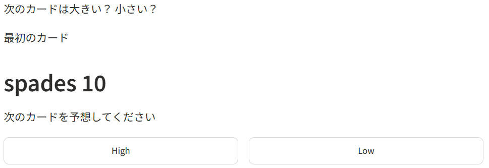
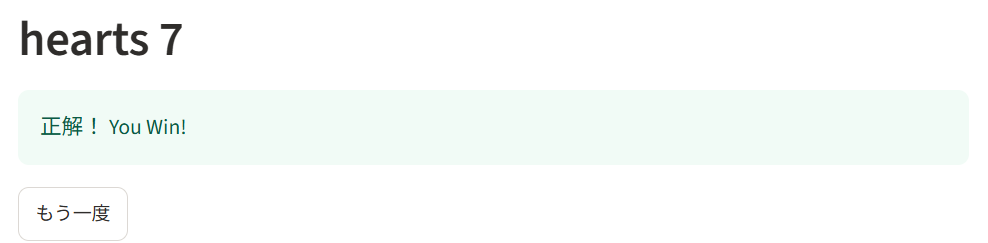

# High & Low

ここではHigh & Lowを遊べます

## 遊び方

カードの数字は1~13です  
カードは完全にランダムに出ます

最初に表示されたカードに比べ、次のカードの数字がHighかLowかを予想します  
当てられたら勝ち！外したら負け！  
例）スペードの10が最初に出たとき

Lowを選ぶと...  

次のカードが7だったのであなたの勝ち！  
「もう一度」ボタンを押すと再び遊ぶことができます

## URL

↓↓遊ぶときはこちらをクリック↓↓  
[High & Low](https://game-tk.streamlit.app/high_and_low_game)
