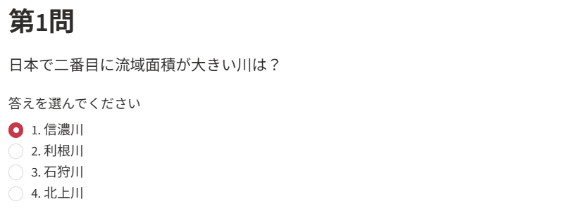
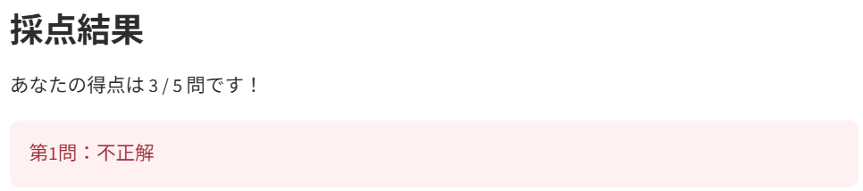

# Quiz app

このアプリでは4択クイズを遊べます

## 遊び方

全5問出題されます  
  
4択のうち1つを選んで、全て回答してから1番下にある「採点」ボタンを押してください  
  
そうすると合計点とそれぞれの問題の正誤判定が出ます  
※回答していない問題がある場合「全ての問題に回答してください」と出て採点は行われません

## URL

↓↓遊ぶときはこちらをクリック↓↓  
[Quiz app](https://game-tk.streamlit.app/quiz)
